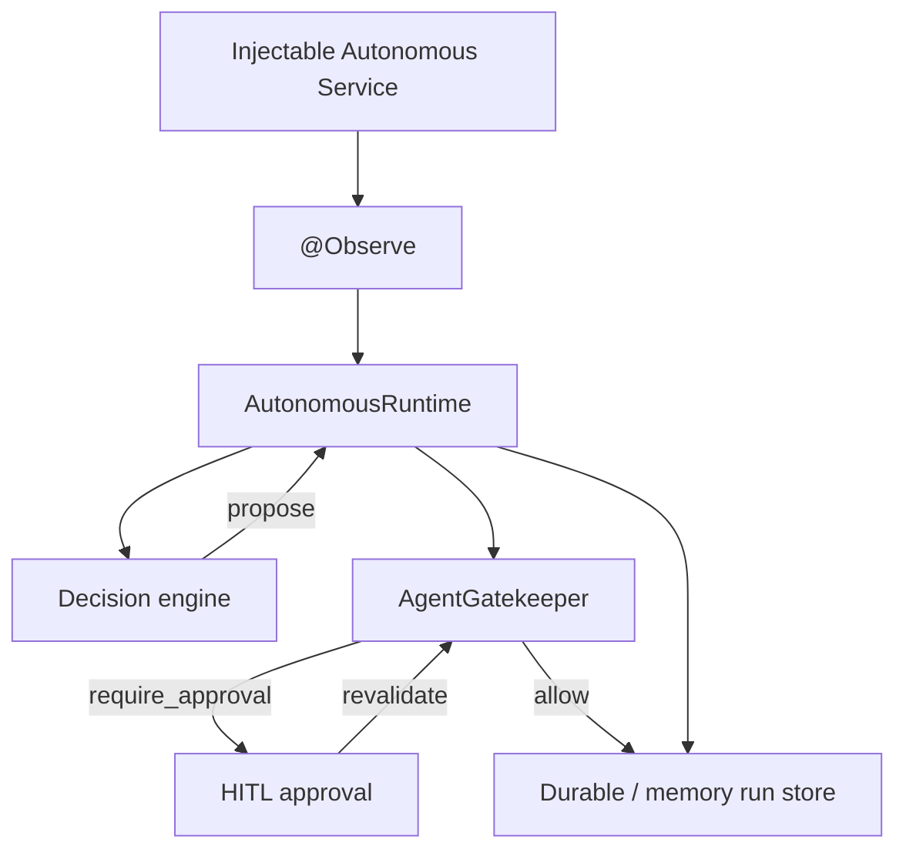

# Autonomous Application Runtime

HazelJS AAR makes **governed autonomy** a native option for ordinary `@Injectable()` services.

Autonomy does **not** mean unrestricted. LLMs are optional. Decisions propose; Gatekeeper authorizes. Side effects require explicit grants. Replays are dry-run by default. Durable execution does not claim exactly-once for arbitrary external effects. Existing apps keep working with negligible overhead when AAR is unused.

## Architecture



## Install

```bash
npm install @hazeljs/autonomous @hazeljs/agent-gatekeeper
# optional peers: @hazeljs/agent @hazeljs/agent-vm @hazeljs/decision
hazel add autonomous --setup
```

## Quick start

```ts
import { Injectable, Autonomous, Observe, Capability, HazelModule } from '@hazeljs/core';
import { AutonomousModule } from '@hazeljs/autonomous';

@Injectable()
@Autonomous({
  id: 'order-operations',
  mode: 'observe-only',
  objective: 'Monitor failed orders',
})
export class OrderMonitor {
  @Observe('orders.failed')
  onFailure(event: { orderId: string }) {
    return { orderId: event.orderId };
  }
}

@HazelModule({
  imports: [AutonomousModule.forRoot()],
  providers: [OrderMonitor],
})
export class AppModule {}
```

## Modes

| Mode                | Behavior                                          |
| ------------------- | ------------------------------------------------- |
| `disabled`          | Off                                               |
| `observe-only`      | Record only                                       |
| `suggest`           | Recommendations only                              |
| `approval-required` | HITL before effects                               |
| `governed-auto`     | Execute granted + Gatekeeper-allowed capabilities |

Default capability grants: **none**.

## Capabilities

```ts
@Capability({
  id: 'orders.retry',
  effect: 'idempotent',
  approval: 'auto',
  idempotencyKey: true,
})
retryOrder(input: { orderId: string }) {
  return this.orders.retry(input.orderId);
}
```

Irreversible capabilities cannot auto-retry without `idempotencyKey` or `reconcile` (`HAZEL_AUTONOMOUS_RETRY_UNSAFE`).

## CLI

```bash
hazel add autonomous --setup
hazel agent runs list
hazel agent runs inspect <run-id>
hazel agent runs timeline <run-id>
hazel agent runs replay <run-id> --dry-run
hazel agent runs diff <run-a> <run-b>
hazel runs:timeline <run-id>   # AAR JSON helper
```

## Migration

- Existing `@Agent` / `@Tool` apps are unchanged.
- Prefer `@Autonomous` for ordinary services that should observe domain events without an LLM loop.
- Do not confuse with roadmap `@AutonomousOptimization` (HTTP self-tuning — separate, unimplemented).

## Production notes

- Use Agent `createDurableRunStore` / SQL for production durability (via `createAgentBackedRunStore`).
- Memory store is for tests and local demos.
- Tenant IDs must come from trusted framework context — never from model arguments.
- Uncertain effects after crash enter `reconcile` — do not blindly re-issue irreversible operations.

## Related

- [Agent OS enforcement boundary](./agent-os-enforcement-boundary.md)
- [Governed runtime](./governed-runtime.md)
- [Decision Plane](./decision-plane.md)
- Architecture: `docs/architecture/autonomous-runtime/`
